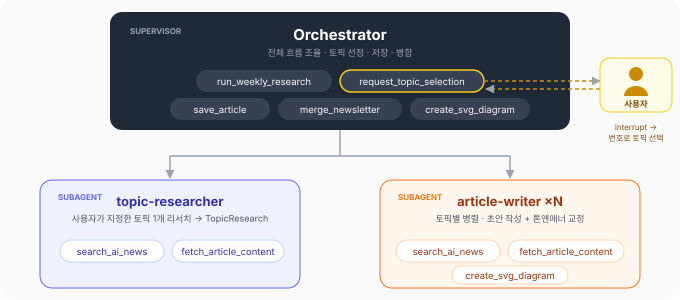

# 오토마타 뉴스레터 자동화
<div align="center">
  
</div>

<p align="center">매주 수요일 발행되는 AI 뉴스레터 <b>오토마타</b>의 뉴스 수집부터 기사 작성·발행까지 자동화하는 멀티에이전트 시스템</p>

<p align="center">
  
</p>

<p align="center">
  
</p>

## 설계 결정

| 결정 | 이유 |
|------|------|
| **deepagents (LangGraph를 직접 사용하는 대신)** | `StateGraph` 노드/엣지 보일러플레이트 없이 dict 기반 에이전트 정의로 로직에 집중. 내장 Todo-list로 멀티스텝 작업 추적, `FilesystemBackend`로 로컬 파일 직접 읽기/편집 |
| **결정론적 리서치 파이프라인** | `run_weekly_research`를 고정 검색 플랜 → 중복제거 → 날짜필터 → 점수 랭킹 → fetch → 배치 요약의 Python 파이프라인으로 구현 |
| **후보 목록을 모델 컨텍스트에서 분리** | 수십 개 후보가 모델 컨텍스트에 들어가면 토큰 낭비 + 번호↔토픽 매핑 오류 발생 → 후보는 `candidates.json`에만 저장하고 모델에는 한 줄 결과만 반환. 선정 도구가 파일을 직접 읽어 토픽을 확정 |
| **실행 모드별 도구 등록** | "사용자에게 물어볼지", "리서치를 할지"를 모델 판단에 맡기지 않음 → `--hitl`이면 `request_topic_selection`, 아니면 `auto_select_topics`만 등록. 빈 슬롯이 없으면 리서치 도구 자체를 제외 |
| **HITL** | 완전 자동화 과정에서 토픽 품질이 저하되는 문제를 확인 → 토픽 선정 단계에서만 LangGraph `interrupt()`로 멈추고 사용자가 번호로 선택, `Command(resume=...)`로 재개 |
| **멀티턴 피드백 루프** | 생성 후에도 같은 스레드에서 수정 요청을 이어가야 함 → SQLite 체크포인터로 스레드 히스토리를 영속화, `--feedback`으로 재생성 없이 이어서 반영 |
| **리서치 결과 캐싱** | 리서치가 가장 비싼 단계(시간·비용) → 결과 파일이 있으면 재사용, `--refresh`로만 재수집 |
| **배치 LLM 요약** | 후보별 개별 요약은 후보 수만큼 API 호출이 늘어남 → 전체 후보를 저가 모델(Haiku) 단일 배치 콜로 요약 |
| **실행 텔레메트리 + 트레이싱** | 실행별 비용·성능 추적 → 토큰 사용량, 도구 호출 수, 실행 시간을 `run_metrics.json`으로 저장하고 에이전트 트레이스는 LangSmith로 시각화해 프롬프트 디버깅에 활용 |

## 에이전트 Tools 목록

| 에이전트 | 도구 | 역할 |
|----------|------|------|
| **Orchestrator** | `run_weekly_research` | 7개 카테고리에서 이번 주 AI 뉴스 후보를 수집·랭킹·요약해 `candidates.json`에 저장 (Python 파이프라인) |
| | `request_topic_selection` | 후보 목록을 사용자에게 보여주고 `interrupt()`로 멈춰 번호로 토픽 선택 (`--hitl`을 지정하면 사용, 지정하지 않으면 `auto_select_topics`가 점수 상위 N개 자동 선택) |
| | `save_article` | 완성된 기사를 `articles/{날짜}/0X_topic.md`로 저장 |
| | `merge_newsletter` | 기사들을 목차·머리말·맺음말과 합쳐 `newsletter.md` 생성 |
| | `create_svg_diagram` | 기존 다이어그램을 생성·수정 |
| **topic-researcher** | `search_ai_news` | Tavily로 화이트리스트 도메인(공식 블로그·테크 미디어)의 최신 뉴스 검색 |
| | `fetch_article_content` | URL의 본문·제목·메타데이터 추출 |
| **article-writer** | `search_ai_news` · `fetch_article_content` | 초안 작성 전 토픽별 사실 보강 리서치 |
| | `create_svg_diagram` | 기사 내용을 설명하는 SVG 다이어그램 생성 (필요한 경우에만 생성) |

## 실행 방법

### 환경 설정

```bash
cp .env.example .env
# .env에서 설정:
# ANTHROPIC_API_KEY=...
# TAVILY_API_KEY=...
# OPENAI_API_KEY=...       # 리서치 후보 관련성 스코어링에 사용
# LANGSMITH_TRACING=true   # 선택사항 — LangSmith 모니터링
# LANGCHAIN_API_KEY=...    # 선택사항
```

### 설치

```bash
uv sync
```

### 실행

```bash
# 다음 수요일 발행용 뉴스레터 생성 (아티클 4개)
uv run python run.py

# 특정 날짜 지정
uv run python run.py --date 2026-01-22

# Human-in-the-Loop 모드 (토픽 직접 선택)
uv run python run.py --hitl

# X, Y는 반드시 포함하고 나머지 2개는 후보에서 선택
uv run python run.py --topics "X, Y" --count 4 --hitl

# 리서치 캐시 무시하고 재수집
uv run python run.py --refresh

# 기존 뉴스레터에 대한 피드백을 이어서 반영
uv run python run.py --feedback 2026-01-15

# 빠른 테스트 (아티클 1개만)
uv run python run.py --quick

# 기존 아티클 미리보기 / 병합만 수행
uv run python run.py --preview 2026-01-15
uv run python run.py --merge 2026-01-15
```
